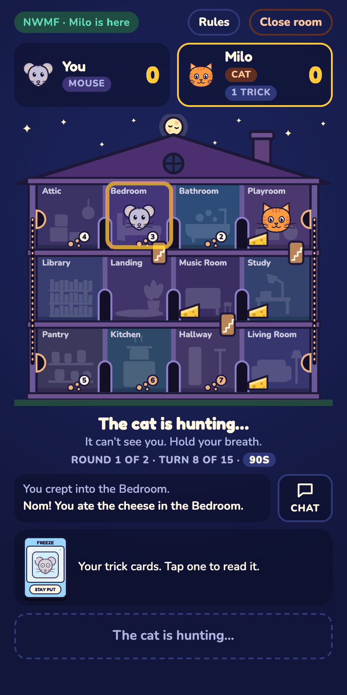
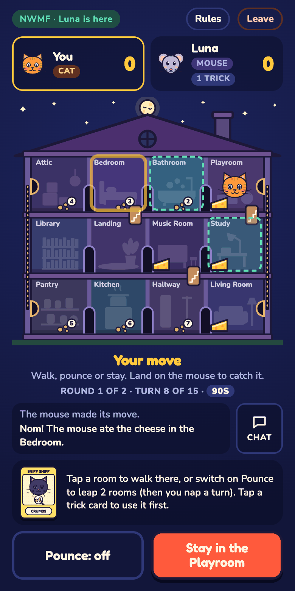
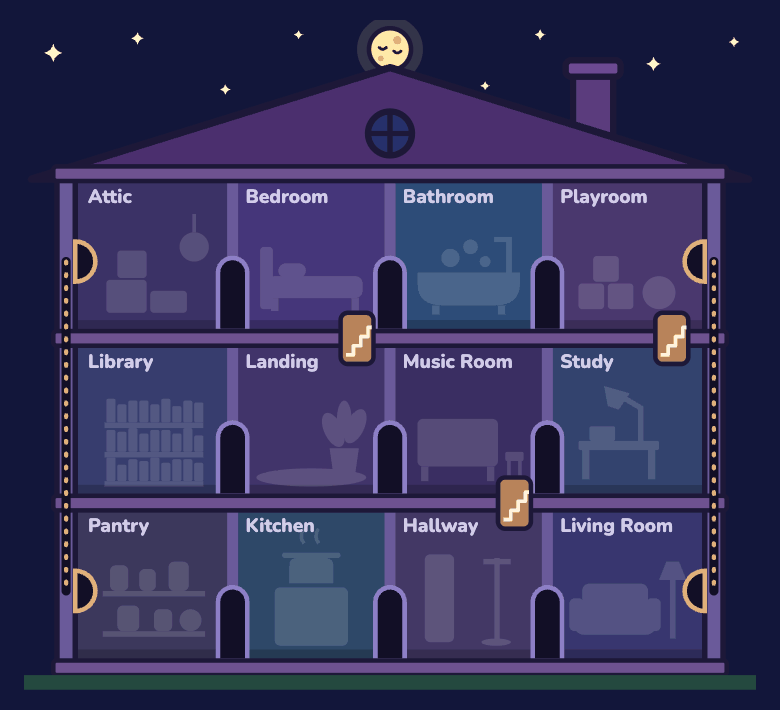
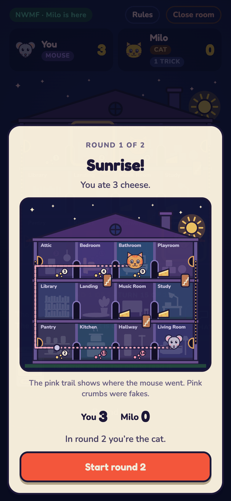

# Midnight Crumbs

A cat-and-mouse game for two phones. One of you is a mouse sneaking through a sleeping house to eat cheese. The other is the cat, hunting it with nothing but crumbs and clues to go on. Then you swap.

## ▶ [Play Midnight Crumbs](https://mdeskn.github.io/midnight-crumbs/)

Open the link on both phones. There's nothing to install and no account to make.

  
  &nbsp;
  

<em>The same moment on both phones. Left, the mouse: it can see itself in the Bedroom, where it just ate the cheese, and its fake crumbs in pink. Right, the cat: no mouse in sight, only crumbs. But the vanished cheese gave the mouse away, and the Bedroom is close enough to pounce on.</em>

## Contents

- [The game in 30 seconds](#the-game-in-30-seconds)
- [Starting a game](#starting-a-game)
- [Rules](#rules): [the house](#the-house), [setting up a round](#setting-up-a-round), [taking turns](#taking-turns), [crumbs](#crumbs), [trick cards](#trick-cards), [end of a round](#end-of-a-round), [scoring](#scoring), [time limit](#time-limit)
- [Tips](#tips)
- [Buttons and screens](#buttons-and-screens)
- [If something goes wrong](#if-something-goes-wrong)
- [Hosting your own copy](#hosting-your-own-copy)
- [How it works](#how-it-works)

## The game in 30 seconds

- You play 2 rounds. Each of you is the mouse once and the cat once.
- Only the mouse's phone shows where the mouse is.
- Each turn the mouse moves one room, then the cat moves.
- The mouse scores 1 point for each piece of cheese it eats. But when cheese vanishes, the cat knows where the mouse is.
- The mouse leaves crumbs behind. The cat sees them 2 turns late.
- The cat scores 2 points if it lands in the mouse's room.
- Most points after both rounds wins.

## Starting a game

1. Both players open the game and type a name.
2. One player taps **Start a game**. A 4-letter code appears.
3. Send the code to the other player, or tap **Send invite link** to send a link with the code already filled in.
4. The other player types the code and taps **Join**. The game starts as soon as they're in.

Who plays the mouse first is picked at random. Keep both screens on while you play. The phone that started the game runs it, so if that phone locks, the game pauses for both of you.

## Rules

### The house

The house has three floors with four rooms each.

| Floor | Rooms, left to right |
|---|---|
| Top | Attic, Bedroom, Bathroom, Playroom |
| Middle | Library, Landing, Music Room, Study |
| Ground | Pantry, Kitchen, Hallway, Living Room |

There are three ways to get from one room to another:

- **Doorways** join rooms that are next to each other on the same floor. The cat and the mouse can both use them. On the map they're the dark arches between rooms.
- **Stairs** join the Bedroom and the Landing, the Playroom and the Study, and the Music Room and the Hallway. The cat and the mouse can both use them. On the map they're the little staircase badges on the floors.
- **Mouse holes** run inside the outer walls. One joins the Attic and the Pantry, the other joins the Playroom and the Living Room. Only the mouse fits through them. On the map they're the dotted lines inside the left and right walls, with an arched hole at each end.

### Setting up a round

- The cat starts on the Landing.
- 6 pieces of cheese go into random rooms, never the Landing. Both players can see the cheese.
- Each player gets 2 trick cards from their own pile. The mouse and the cat have different cards.
- The mouse chooses which mouse hole to come out of: the Attic, the Playroom, the Pantry or the Living Room. From then on, only the mouse's phone shows where the mouse is.

### Taking turns

Each turn, the mouse moves first and then the cat. The sun comes up after 15 turns.

**The mouse's move**

1. You may play one trick card.
2. Move to a room connected to yours: through a doorway, up or down stairs, or through a mouse hole. You have to move, and you can't move into the cat's room. If every way out is blocked, you stay where you are.
3. If you end your move in a room with cheese, you can eat it or leave it. Eating scores a point, but the cheese disappears on both phones, so the cat knows exactly where you are.
4. You leave a crumb in the room you just left.

**The cat's move**

1. You may play one trick card first. It works straight away, so you can use what you learn before you move.
2. Then do one of these:
   - **Walk** to a room connected to yours by a doorway or stairs. Cats don't fit through mouse holes.
   - **Stay** where you are.
   - **Pounce** on a room exactly 2 steps away. After a pounce you nap through your next turn, so the mouse gets two moves in a row.
3. If you end your move in the mouse's room, you catch it. A pounce only catches the mouse in the room you land in, not in the room you leap over.

### Crumbs

Crumbs are how the cat tracks the mouse.

- Every room the mouse leaves gets a crumb.
- A crumb shows up on the cat's phone **2 turns after** the mouse dropped it.
- The number on a crumb says how many turns ago the mouse left that room.
- When the cat walks into a room, it sees the crumbs there right away ("Fresh crumbs!").
- Crumbs stay for the whole round.

On the mouse's phone, faded crumbs are ones the cat can't see yet, and pink crumbs are fakes from Decoy Crumb. The cat's phone shows fakes just like real crumbs.

### Trick cards

You start each round with 2 trick cards and get 1 more at the start of turns 5 and 10. You can play one card per turn. You can see how many cards the other player is holding, but not which ones. When the mouse plays a card, the cat is told that it did, but not which card it was.

Each role has its own pile of 10 cards, shuffled again every round.

**Mouse cards**

| Card | In the pile | What it does |
|---|---|---|
| Tiptoe | 3 | Your move this turn leaves no crumb. |
| Decoy Crumb | 3 | Drop a fake crumb in a room up to 2 rooms away from you. It can't go in the room you're leaving or in the cat's room. It shows up for the cat just like a real crumb would. |
| Teacup | 2 | Hide in a teacup after you move. If the cat comes into your room before your next turn, you're not caught, but the cat finds out where you are, so you'll want to run. |
| Freeze | 2 | Stay where you are this turn and leave no crumb. You can't use it while the cat is in your room. |

**Cat cards**

| Card | In the pile | What it does |
|---|---|---|
| Twitchy Whiskers | 3 | Find out if the mouse is in a room connected to yours by a doorway, stairs or mouse hole. If it is, those rooms get dotted rings on your map. |
| Loud Meow | 3 | Find out which floor the mouse is on. That floor gets dotted rings on your map. |
| Knock Over | 2 | Knock a vase over one way out of your room: a doorway, stairs or a mouse hole. Nobody can use that way for 3 turns. |
| Sniff Sniff | 2 | Every crumb in the house shows up now, even fresh ones. |

### End of a round

A round ends when:

- the sun comes up after turn 15,
- the cat catches the mouse, or
- the mouse eats all 6 pieces of cheese.

Both phones then show the whole route the mouse took, every crumb (fakes in pink) and the scores so far.

When you've both tapped **Start round 2**, you swap roles and play the second round. After it, tap **Play again** for a new game. Whoever started as the cat last time starts as the mouse.

### Scoring

- The mouse scores **1 point** for each piece of cheese it eats. It keeps those points even if it gets caught.
- The cat scores **2 points** for catching the mouse.
- After 2 rounds, the player with more points wins. Equal points is a tie.

### Time limit

You have 90 seconds for each move. The clock is under the house. If it runs out, the game moves for you: the mouse comes out of a random mouse hole, or moves to a random connected room without eating, and the cat stays where it is. If someone's connection drops, their clock pauses until they're back.

## Tips

**Playing the mouse**

- A pounce reaches rooms 2 steps away. Eating when the cat is 3 or more steps away is safe. Any closer, play a Teacup first or be ready to run.
- The cat can't follow you through a mouse hole.
- Right after you eat, the cat knows where you are. Tiptoe or a Decoy Crumb on your next move makes you much harder to follow.

**Playing the cat**

- The Music Room is the middle of the house. From there you can walk to 3 rooms and pounce on 5 more.
- On your turn, a crumb marked 2 means the mouse left that room 2 turns ago. It's now at most 3 moves away from it.
- Watch the cheese. The mouse has to come to it to score.
- A vase knocked over a mouse hole cuts off the mouse's favourite escape route.

## Buttons and screens

- **Rules** shows the rules inside the game.
- **Chat** lets you send messages or quick reactions to the other player.
- Tap the box of messages under the house to see the latest things that happened.
- **Close room** (for the player who started the game) ends the game for both of you. **Leave** (for the other player) lets you come back later with the same code.
- The pill at the top shows the game code and whether the other player is connected.

## If something goes wrong

- **"Looking for your friend's game…" doesn't go away.** Check the code, and make sure the game is open on the other phone with its screen on.
- **The game can't connect, or moves are slow.** The phones try to connect directly. Some networks block that, often mobile data, and then the game sends moves through public relay servers instead, which is a bit slower. Switching one phone between Wi-Fi and mobile data can help.
- **A phone locked or the page closed.** Open the game again on that phone. For a few hours it offers **Resume hosting game** or **Rejoin game**. While someone is away, the other phone says so and the clock waits.
- **"Your move did not go through."** The connection dropped for a moment. Make your move again.
- **Trying it on one computer.** Open the game in two different browsers, or in a normal window and a private window. Two tabs in the same browser count as the same player and can't play each other.

## Hosting your own copy

The whole game is one file, `index.html`, with no build step. To put your own copy on GitHub Pages:

1. Fork this repository, or put `index.html` in a repository of your own.
2. Open **Settings → Pages**, choose **Deploy from a branch**, pick `main` and `/ (root)`, and save.
3. After a minute or two, the game is at `https://<your-user>.github.io/<repository>/`.

The page needs to be served over HTTPS (GitHub Pages does that) to encrypt the moves between the phones. To try it on your own computer, run `python3 -m http.server` in this folder and open `http://localhost:8000`.

## How it works

Everything is in `index.html`. There is no server of its own.

- **Connection:** the phones try to connect directly with [PeerJS](https://peerjs.com). PeerJS's public server only introduces the phones to each other. When there's no direct line, game messages go through two free public MQTT brokers ([HiveMQ](https://www.hivemq.com/mqtt/public-mqtt-broker/) and [EMQX](https://www.emqx.com/en/mqtt/public-mqtt5-broker)) at the same time, so either one can be down. No account is needed. The public brokers are free test servers with no guarantees.
- **Fair play:** the phone that started the game holds the full game state and checks every move. Each phone only receives what its player is allowed to see. The cat's phone never gets the mouse's room, the mouse's cards, fake crumbs, or crumbs that haven't shown up yet. Because the host's phone has everything, a host playing the cat could peek with the browser's developer tools. The other player can't.
- **Privacy:** moves and views are encrypted between the two phones (ECDH key exchange and AES-GCM in the browser), so nobody listening on the public relay can read them.
- **Art:** the house, the cat, the mouse and the cards are all drawn as SVG in code.

### Changing the numbers

The numbers that shape a round are at the top of the rules engine in `index.html`:

| Setting | Now | What it controls |
|---|---|---|
| `NIGHT` | 15 | Turns before sunrise |
| `CHEESE` | 6 | Pieces of cheese at the start of a round |
| `DELAY` | 2 | Turns before a crumb shows up for the cat |
| `CATCH` | 2 | Points for catching the mouse |
| `DRAWS` | 5 and 10 | Turns that start with both players drawing a trick card |
| `VASE` | 3 | Turns a knocked-over vase blocks its way |
| `TURN_MS` | 90000 | Milliseconds for each move |
| `DECK` | see [Trick cards](#trick-cards) | How many of each card are in each pile |

## Credits

Uses [PeerJS](https://github.com/peers/peerjs) and [MQTT.js](https://github.com/mqttjs/MQTT.js) (both MIT licence) and the Google Fonts Fredoka and Nunito (SIL Open Font License). The cats come from [Boom Whiskers](https://mdeskn.github.io/boom-whiskers/).
